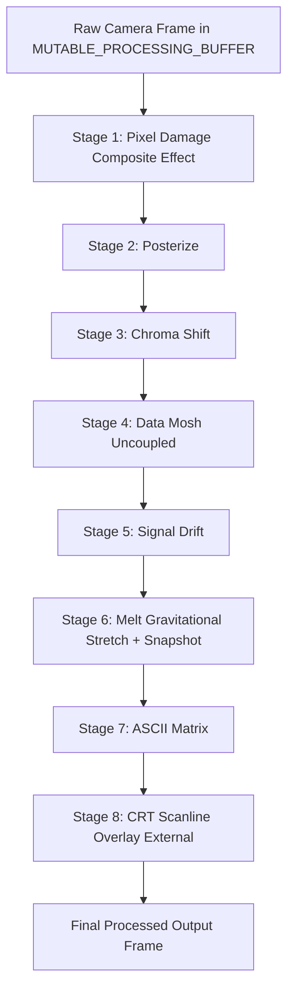

# GLITCH BOOTH

An experimental digital installation designed to explore the aesthetics of technology in states of distress while giving the user agency and control. **Glitch Booth** doesn't just take photos; it documents the digital ghost in the machine, transforming fleeting electronic anomalies into a raw, tactile urban artifact.

Powered by [**Dirtcake Studio**](https://dirtcakestudio.com)

---

## ⚡ Core Concepts

### 🔬 The Glitch Pipeline
Bare-metal input modules process raw sensor data in real-time. Custom logic, controlled interactively by the user, manipulates the visuals pre-capture, applying the precise amount of intentional disruption directly to the core image processing pipeline.

### 🧾 Physical Materialization
Each distorted digital capture is translated on the fly into a low-fi, high-contrast analog thermal receipt print. This process bridges the gap between digital decay and tangible physical ephemera, leaving you with an artifact to hold in your hand.

### 🔗 The Hybrid Loop
Every physical receipt includes an embedded direct token link. Scanning it instantly hooks you back into the online digital archive gallery, allowing you to view, inspect, or download the original uncompressed high-contrast capture.

---

## 🌐 Connected Ecosystem

*   **Glitch Booth Web:** [glitchbooth.online](https://glitchbooth.online)
*   **Glitch Booth Instagram:** [@glitchbooth.online](https://www.instagram.com/glitchbooth.online)

---

## 🛠️ Behind the Installation

**Dirtcake Studio** is a DIY-focused, tech-forward creative studio based in Istanbul. Established in 2023 by Tuğba Girgiç and Cihan Gelerli, the studio designs and produces limited-edition designer toys, interactive installations, and urban collectibles that challenge the contemporary art establishment.

## Powered by [**Dirtcake Studio**](https://www.dirtcakestudio.com)

- Website: [https://www.dirtcakestudio.com](https://www.dirtcakestudio.com)
- Instagram: [@dirtcakestudio](https://www.instagram.com/dirtcakestudio/)
- Twitter / X: [@dirtcakestudio](https://www.x.com/dirtcakestudio/)
- Behance: [dirtcakestudio](https://www.behance.net/dirtcakestudio)
- Bluesky: [dirtcakestudio.bsky.social](https://bsky.app/profile/dirtcakestudio.bsky.social)
- Youtube: [@dirtcakestudio](https://www.youtube.com/@dirtcakestudio)
- **Cihan Gelerli Instagram:** [@gelerli](https://www.instagram.com/gelerli/)

---

# Current Development

## GLITCHBOOTH Effects Revamp — Masterplan (v4.1 Final Production Specification)

> [!IMPORTANT]
> **Adherence to Engineering & AI Implementation Rules:**
> **NO PIPELINE OR SERVER CODE HAS BEEN MODIFIED YET.** This document is the ultimate, definitive implementation specification. It fully preserves all granular architecture, exact byte-level memory tables, pipeline flowcharts, 8-phase implementation mechanics, and verification governance from the baseline masterplan, while incorporating every verified audit correction:
> - **Aesthetics First, Bounded Stability Always**: Visual richness, organic randomness, and tactile responsiveness are the primary goals. Performance constraints exist to prevent thread lock-ups or dropped frames on the Pi 5, not to make the visual effect sterile or rigid.
> - **Spatially Balanced Dynamic Melt**: Non-linear backward vertical coordinate stretching sampling from an immutable pre-melt frame snapshot (`STATIC_MELT_SNAPSHOT`), with dynamic column strides, seed-rank grouping, and fractional subsampling to ensure perfectly uniform screen-wide coverage.
> - **Dead Write-Mask Removed**: `STATIC_MELT_MASK` is deleted, saving 300 KiB (307,200 B) and eliminating dead per-frame write overhead.
> - **Exact Bounded Scratch Memory Model**: Reconciled memory table accounting for `MELT_DRIP_WORK_BUFFER` (480x4x3 float32 = 23,040 B = ~0.022 MiB), compression tiers (240x320x3, 120x160x3, 60x80x3 uint8 = 302,400 B = ~0.288 MiB), dedicated Posterize buffers (1,536,000 B = ~1.465 MiB), snapshot buffer (921,600 B = ~0.879 MiB), totaling exactly **2,783,040 B (~2.654 MiB)** of new persistent buffers.
> - **Encapsulated, Injectable Handlers**: Separation of drip collection (`_collect_melt_drips`) and rendering (`_render_melt_drips`) allowing direct test harness injection without test-production drift.
> - **Governor & Remapping Synchronization**: Governor effect weights are derived dynamically from active mapped effects, ensuring frame pacing remains invariant under remapping.
> - **Clean Telemetry v2 Epoch**: Capture-time immutable snapshot packaging (`capture_log_v2.jsonl`) avoiding per-frame heap churn.
> - **Zero Git Pushes**: The AI assistant will **NEVER** run `git push`. All version control commits and pushes are executed exclusively by the user.

---

### 1. Executive Summary & Production Objectives

The GLITCHBOOTH Effects Revamp modernizes the booth's visual processing engine while maintaining absolute stability on the Raspberry Pi 5 (1GB RAM). This update achieves five key engineering objectives:

1. **Gravitational Melt Deformation with Uniform Coverage & Strict Bounds**: Replace superficial pixel stamping with an explicit non-linear coordinate transformation operating against an immutable pre-melt frame snapshot (`STATIC_MELT_SNAPSHOT`), backed by a 4-column profile ($x_0-1, x_0, x_0+1, x_0+2$ where $1 \le x_0 < \text{WIDTH}-2$ and $L > 0$), deterministic ascending-extent overlap ordering, seed-rank fractional subsampling, and outer-edge neon bleeding.
2. **Plug-and-Play Architectural Decoupling & Complete Default Mapping**: Establish `effects_config.py` as a purely declarative metadata registry containing the complete six-knob default mapping. Validation strictly restricts assignable effect IDs to top-level registered handlers, keeping internal sub-effects (`packet_corruption`, `pixelate`) encapsulated within the unified `pixel_damage` composite.
3. **Reconciled Memory Inventory (2.654 MiB New Persistent Footprint)**: Document exact persistent byte footprints for all core new buffers (**2.632 MiB**) plus pre-allocated staging buffers (**0.022 MiB**), totaling **2.654 MiB**, with zero canvas reallocations inside the hot image-processing render loop.
4. **Telemetry v2 Epoch Migration with Frame-Packet Metadata Binding**: Launch an isolated v2 telemetry ledger (`capture_log_v2.jsonl`) capturing an atomic runtime mapping snapshot bound directly as an immutable metadata packet alongside the memory-copied captured frame at State 1B.
5. **Strict Post-Phase Governance & Hardware Testing**: Enforce focused unit/regression sanity checks after every phase, paired with full-stack live hardware smoke tests on the Raspberry Pi 5 (`dev` branch) at major integration milestones and release gates.

---

### 2. Primary Constraints & Architectural Guardrails

* **Zero Git Pushes**: The AI assistant will **NEVER** run `git push`. All version control commits and pushes are executed exclusively by the user.
* **Aesthetics First, Bounded Stability Always**: Visual richness, organic randomness, and tactile responsiveness are paramount. Guardrails exist to protect Pi 5 thread stability, not to make the visual effect sterile or rigid.
* **Strict Memory Contiguity (`order='C'`)**: All image arrays and scratch buffers must remain contiguous C-order NumPy arrays (`dtype=np.uint8`, `order='C'`), minimizing per-frame Python object churn inside the render loop.
* **Scoped Allocation Guarantee**: Zero per-frame frame-canvas reallocations are strictly enforced inside the core render loop. Scratch buffers and tier buffers are pre-allocated at module scope.
* **Locked Pipeline Order & Plug-and-Play Flexibility**: The deterministic sequential execution order in `server.py` guarantees visual consistency. Stage execution is decoupled from active knob mapping. Unassigned stages receive an intensity of `0.0` and execute zero image-processing compute (early return).
* **Configuration-Driven Remapping Model**: Reassignment is configuration-driven via application restart (editing `effects_config.py` defaults or reloading the configuration object at startup). This eliminates asynchronous runtime race conditions, ensuring UI labels, pipeline execution, and capture telemetry always share a uniform configuration snapshot.
* **CRT Overlay Isolation**: CRT scanlines, aperture masks, and phosphor green glow are applied strictly outside the effect registry at the conclusion of frame processing (`if CRT_ENABLED: cv2.multiply(MUTABLE_PROCESSING_BUFFER, CRT_MASK, scale=1.0/255.0)`).
* **Continuous Hardware Operation**: Camera capture, thermal receipt printing (`/dev/usb/lp0` via disk-backed images), countdowns, audio, QR rendering, and ImageKit sync remain uninterrupted.

---

### 3. Reconciled Buffer Inventory & Memory Budget (Pi 5 1GB)

All persistent memory is pre-allocated at startup. Total binary footprint of newly added persistent buffers is exactly **2.654 MiB** (2,783,040 bytes):

| Buffer Name | Status | Shape | Dtype | Item Size | Exact Size (Bytes / MiB) | Owner / Lifecycle Strategy |
| :--- | :--- | :--- | :--- | :--- | :--- | :--- |
| `MUTABLE_PROCESSING_BUFFER` | Existing | `(480, 640, 3)` | `uint8` | 1 byte | 921,600 B (~0.879 MiB) | Active live camera processing canvas |
| `SHARED_GRAY_BUFFER` | Existing | `(480, 640)` | `uint8` | 1 byte | 307,200 B (~0.293 MiB) | Shared scratch for luminance conversions (mutually exclusive) |
| `STATIC_MELT_GRAY_BUFFER` | Existing | `(480, 640)` | `uint8` | 1 byte | 307,200 B (~0.293 MiB) | Sequential scratch: used by Melt during loop, reused by capture print prep |
| `STATIC_NOISE_BUFFER` | Existing | `(480, 640, 3)` | `uint8` | 1 byte | 921,600 B (~0.879 MiB) | Global static noise scratch buffer |
| `COMPRESSION_STAGE_BUFFER` | Existing | `(480, 640, 3)` | `uint8` | 1 byte | 921,600 B (~0.879 MiB) | Legacy compression scratch (retired upon Phase 5 tier adoption) |
| `UI_DISPLAY_BUFFER` | Existing | `(480, 640, 3)` | `uint8` | 1 byte | 921,600 B (~0.879 MiB) | Memory-mapped display buffer ingested by Pygame kiosk |
| `LATEST_CAMERA_FRAME` | Existing | `(480, 640, 3)` | `uint8` | 1 byte | 921,600 B (~0.879 MiB) | Camera worker double buffer under `cam_raw_lock` |
| `FROZEN_DISPLAY_BUFFER` | Existing | `(480, 640, 3)` | `uint8` | 1 byte | 921,600 B (~0.879 MiB) | Post-capture display freeze buffer |
| `FROZEN_PRINT_BUFFER` | Existing | `(640, 480)` | `uint8` | 1 byte | 307,200 B (~0.293 MiB) | Rotated monochrome thermal print bitmap buffer |
| `STATIC_ROW_BUFFER` | Existing | `(640, 3)` | `uint8` | 1 byte | 1,920 B (~0.002 MiB) | Row scratch used for Signal Drift horizontal rolls |
| `GHOST_GREEN_BUFFER` | Existing | `(480, 640)` | `uint8` | 1 byte | 307,200 B (~0.293 MiB) | Legacy scratch canvas |
| `COMPRESSION_TIER_1` | **New** | `(240, 320, 3)` | `uint8` | 1 byte | 230,400 B (~0.220 MiB) | Pre-allocated tier 1 downscale scratch ($320\times240$) for Pixel Damage |
| `COMPRESSION_TIER_2` | **New** | `(120, 160, 3)` | `uint8` | 1 byte | 57,600 B (~0.055 MiB) | Pre-allocated tier 2 downscale scratch ($160\times120$) for Pixel Damage |
| `COMPRESSION_TIER_3` | **New** | `(60, 80, 3)` | `uint8` | 1 byte | 14,400 B (~0.014 MiB) | Pre-allocated tier 3 downscale scratch ($80\times60$) for Pixel Damage |
| `POSTER_WORK_BUFFER` | **New** | `(480, 640, 3)` | `uint8` | 1 byte | 921,600 B (~0.879 MiB) | Dedicated Posterize color mapping canvas |
| `POSTER_EDGES` | **New** | `(480, 640)` | `uint8` | 1 byte | 307,200 B (~0.293 MiB) | Dedicated Canny edge extraction canvas |
| `POSTER_GRAY_BUFFER` | **New** | `(480, 640)` | `uint8` | 1 byte | 307,200 B (~0.293 MiB) | Dedicated Posterize grayscale buffer |
| `STATIC_MELT_SNAPSHOT` | **New** | `(480, 640, 3)` | `uint8` | 1 byte | 921,600 B (~0.879 MiB) | Immutable pre-melt source snapshot for bilinear sampling |
| `MELT_DRIP_WORK_BUFFER` | **New** | `(480, 4, 3)` | `float32` | 4 bytes | 23,040 B (~0.022 MiB) | Staging scratch for 4-column profile bilinear sampling and neon bleed |
| `STATIC_BLOCK_BUFFER` | Existing | `(32, 24, 3)` | `uint8` | 1 byte | 2,304 B (~0.002 MiB) | Reused by Packet Corruption |
| `GLOBAL_NOISE_BUFFER` | Existing | `(32, 24, 3)` | `uint8` | 1 byte | 2,304 B (~0.002 MiB) | Reused by Packet Corruption |
| `CORRUPTION_ENERGY` | Existing | `(15, 26)` | `float32` | 4 bytes | 1,560 B (~0.001 MiB) | Packet corruption decay grid |
| `CORRUPTION_MODE` | Existing | `(15, 26)` | `uint8` | 1 byte | 390 B (~0.0003 MiB) | Packet corruption mode grid |
| `DATAMOSH_VX` | Existing | `(15, 26)` | `int8` | 1 byte | 390 B (~0.0003 MiB) | Datamosh motion vector grid |
| `DATAMOSH_WORK_BUFFER` | Existing | `(480, 640, 3)` | `uint8` | 1 byte | 921,600 B (~0.879 MiB) | Datamosh block displacement canvas |
| `DATAMOSH_PREV_FRAME` | Existing | `(480, 640, 3)` | `uint8` | 1 byte | 921,600 B (~0.879 MiB) | Datamosh history reference frame |
| `DATAMOSH_DIFF_BUFFER` | Existing | `(480, 640, 3)` | `uint8` | 1 byte | 921,600 B (~0.879 MiB) | Datamosh absdiff scratch buffer |
| `DATAMOSH_GRAY_DIFF` | Existing | `(480, 640)` | `uint8` | 1 byte | 307,200 B (~0.293 MiB) | Datamosh grayscale difference |
| `CHANNEL_SHIFT_BUFFER` | Existing | `(480, 640)` | `uint8` | 1 byte | 307,200 B (~0.293 MiB) | Chroma Shift channel scratch |
| `SLICE_SHIFT_BUFFER` | Existing | `(480, 640, 3)` | `uint8` | 1 byte | 921,600 B (~0.879 MiB) | Allocated slice displacement scratching array |
| `GHOST_FRAME_BUFFER` | Existing | `(480, 640, 3)` | `uint8` | 1 byte | 921,600 B (~0.879 MiB) | Chroma Shift ghost blend buffer |
| `ASCII_LOWRES_GRAY` | Existing | `(60, 80)` | `uint8` | 1 byte | 4,800 B (~0.004 MiB) | ASCII downscale luminance canvas |
| `ASCII_UPRES_GRAY` | Existing | `(480, 640)` | `uint8` | 1 byte | 307,200 B (~0.293 MiB) | ASCII structured glyph canvas |
| `ASCII_BLOCK_BUFFER` | Existing | `(60, 80, 8, 8)` | `uint8` | 1 byte | 307,200 B (~0.293 MiB) | ASCII 4D tile indexing canvas |
| `ASCII_TILES` | Existing | `(16, 8, 8)` | `uint8` | 1 byte | 1,024 B (~0.001 MiB) | Pre-rendered ASCII font glyphs |
| `ASCII_GREEN_BUFFER` | Existing | `(480, 640, 3)` | `uint8` | 1 byte | 921,600 B (~0.879 MiB) | ASCII phosphor color buffer |
| `CRT_MASK` | Existing | `(480, 640, 3)` | `uint8` | 1 byte | 921,600 B (~0.879 MiB) | CRT scanline/aperture multiplier |

---

### 4. Locked Pipeline Architecture & Default Mapping Contract



#### Complete Default Six-Knob Mapping & Unified Control Contract
The declarative default mapping in `effects_config.py` defines the initial physical control binding:

```python
DEFAULT_KNOB_MAPPING = {
    0: "signal_drift",      # Stage 5
    1: "chroma_shift",      # Stage 3
    2: "posterize",         # Stage 2
    3: "pixel_damage",      # Stage 1 composite (internally manages packet corruption + tiered pixelation)
    4: "melt",              # Stage 6
    5: "ascii_matrix"       # Stage 7
}
# Registered top-level effects unassigned by default: "datamosh" (Stage 4)
# Sub-effects ("packet_corruption", "pixelate") are strictly internal and rejected by validation if mapped as top-level knob effects.
```

* **Startup Reverse-Lookup Construction**: Precomputed **once** at application startup (never inside the per-frame loop):
  ```python
  EFFECT_TO_KNOB = {eff_id: k_idx for k_idx, eff_id in active_mapping.items()}

  def resolve_intensity(effect_id: str, control_packet) -> float:
      k_idx = EFFECT_TO_KNOB.get(effect_id)
      if k_idx is not None and k_idx < len(control_packet.knobs):
          return control_packet.knobs[k_idx] / 1023.0
      return 0.0
  ```
* **Dormancy Enforcement**: Unassigned or dormant effects receive `0.0` intensity and trigger an immediate early return with zero image processing.

---

### 5. Comprehensive 8-Phase Implementation Specification

#### PHASE 0: Baseline Performance & Golden Frames (Hardware Safety Anchor)
* **Goal**: Establish empirical performance benchmarks and reference visual captures on the existing codebase before any modifications.
* **Technical Design**:
  - Run benchmark loop measuring frame times across governor tiers (Low: 15 FPS, Mid: 12 FPS, High: 10 FPS).
  - Dump one uncompressed raw camera frame for standardized benchmark inputs across phases.
  - Generate and save seeded synthetic golden frames for all current effects to detect unintended visual regression during modularization.
* **Acceptance Criteria**: Baseline latency log and golden hashes recorded on Pi 5.

#### PHASE 1: Gravitational Melt Deformation Redesign (Math & Spec)
* **Goal**: Replace pixel-stamping with continuous non-linear vertical coordinate stretching, true 1D vertical bilinear interpolation, dynamic organic column density, ascending-extent overlap precedence, and outer-border neon bleeding.
* **Technical Design**:
  1. **Snapshot Initialization**: At Stage 6 entry, verify shape/dtype equality against `MUTABLE_PROCESSING_BUFFER`. Copy active frame into `STATIC_MELT_SNAPSHOT` (read-only for Melt pass).
  2. **Bounded Gravitational Coordinate Equation & Boundary Guards**:
     Drip origin columns $x_0$ are strictly generated and clipped such that $1 \le x_0 < \text{FRAME\_W} - 2$. For each drip, evaluate length guard: `if L <= 0: continue`. For 4-column profile ($x_0-1, x_0, x_0+1, x_0+2$), starting at origin row $y_0$ with length $L$ and stretch coefficient $s \in [1.0, 3.0)$, destination rows $y$ map back to source rows via:
     $$y_s = y_0 + \frac{y - y_0}{\max\left(1.0, 1.0 + s \cdot \sqrt{\frac{y - y_0}{L}}\right)}$$
     Clamped strictly to domain $[y_0, h - 1]$. Horizontal source coordinates remain unchanged ($x_s = x$).
  3. **1D Vertical Bilinear Sampling**:
     ```python
     y_floor = np.floor(y_float).astype(np.int32)
     y_ceil = np.clip(y_floor + 1, 0, h - 1)
     w_ceil = (y_float - y_floor).astype(np.float32)[:, None, None]
     w_floor = 1.0 - w_ceil
     ```
     Floor and ceil rows are sampled and blended into `MELT_DRIP_WORK_BUFFER`, rounded explicitly (`np.round`), clipped to $[0, 255]$, and written as a contiguous 4-column slice into `MUTABLE_PROCESSING_BUFFER`.
  4. **Dynamic Column Traversal & Seed-Rank Subsampling**:
     Candidate columns are scanned in horizontal order via per-column `flatnonzero` or sliced arrays, scaling stride with knob intensity ($6 \to 4 \to 2$). Drips are emitted by seed rank across columns, with fractional subsampling applied when `MAX_MELT_DRIPS = 120` is reached to guarantee completely symmetrical screen-wide distribution.
  5. **Deterministic Ascending-Extent Overlap Precedence**:
     Drips are rendered in ascending order of downward reach ($y_0 + L$), with tie-breaks resolved by ascending origin column ($x_0$). Greater-extent drips process last, cleanly overwriting lesser-extent overlapping pixel assignments.
  6. **Edge-Restricted Per-Drip Neon Bleeding**:
     Outer columns ($x_0 - 1$ and $x_0 + 2$) receive an $85\%$ source + $15\%$ neon tint. Core columns ($x_0, x_0 + 1$) retain pure camera visual content.
* **Acceptance Criteria**: Verified zero out-of-bounds indexing; smooth vertical coordinate elongation; uniform spatial balance (left/right ratio between $0.8$ and $1.25$).

#### PHASE 2: Registry & Configuration Foundation (`effects_config.py`)
* **Goal**: Centralize declarative metadata and implement rigorous startup validation rejecting sub-effect top-level mappings.
* **Technical Design**:
  - Create `effects_config.py` with `EFFECT_POOL`, `DEFAULT_KNOB_MAPPING`, and `NEON_PALETTES`.
  - Implement `validate_effects_config()` to check unique knob assignments `{0..5}`, valid top-level effect IDs (explicitly rejecting internal sub-effects like `packet_corruption` or `pixelate` from direct knob binding), and integer palette channel ranges (`0–255`).
  - Precompute `EFFECT_TO_KNOB` at startup.
* **Acceptance Criteria**: Startup validation aborts cleanly on malformed configurations, duplicate knob assignments, or invalid sub-effect bindings.

#### PHASE 3: Effect-State & Input Routing Separation
* **Goal**: Untangle Knob 2 and establish state-reset contracts for stateful effects (Data Mosh).
* **Technical Design**:
  - Assign Data Mosh strictly to its dedicated mapping entry.
  - Implement an immediate state-flush routine (`DATAMOSH_VX` cleared, history reset) when intensity transitions to zero.
  - On the first active frame after reset, mark history invalid, copy the current Stage 4 input into `DATAMOSH_PREV_FRAME`, and bypass temporal displacement until a valid history frame is established.
* **Acceptance Criteria**: Disabling Data Mosh leaves zero residual motion artifacts.

#### PHASE 4: Buffer Modularization & Buffer Allocation Audit
* **Goal**: Pre-allocate dedicated scratch buffers and extract inline logic.
* **Technical Design**:
  - Instantiate `POSTER_WORK_BUFFER`, `POSTER_EDGES`, `POSTER_GRAY_BUFFER`, `STATIC_MELT_SNAPSHOT`, `MELT_DRIP_WORK_BUFFER`, and compression tiers (`COMPRESSION_TIER_1` to `COMPRESSION_TIER_3`) at module level with explicit shape/dtype/contiguity checks (`order='C'`).
  - Extract modular stage handlers (`apply_pixel_damage`, `apply_posterize`, `apply_chroma_shift`, `apply_datamosh`, `apply_signal_drift`, `apply_melt_pass`, `apply_ascii_matrix`).
* **Acceptance Criteria**: Unchanged effects maintain 100% visual equivalence against Phase 0 golden frames.

#### PHASE 5: Visual Implementations (Pixel Damage & Posterize with Explicit OpenCV Tiering)
* **Goal**: Implement Split-Range Pixel Damage via verified in-place tiered OpenCV downsampling with explicit `dsize` parameters, and independent Posterize.
* **Technical Design**:
  1. **Split-Range Pixel Damage (Composite Effect)**:
     - Knob raw boundaries:
       - `0`: Bypass and reset state.
       - `1–511`: Packet corruption scales linearly from min to max response: $\text{corr\_intensity} = \frac{\text{raw} - 1}{510.0}$. Pixelation intensity = $0.0$.
       - `512–530`: Identity deadband. Packet corruption held at maximum ($1.0$). Pixelation held at $0.0$ to eliminate block-jump artifact at the transition boundary.
       - `531–1023`: Packet corruption held at maximum ($1.0$). Pixelation intensity $p = \frac{\text{raw} - 531}{492.0}$ scales smoothly from $0.0$ to $1.0$.
     - Tiered Downscaling with Explicit `dsize`:
       - $p \in [0.0, 0.33)$: Target `COMPRESSION_TIER_1` ($320\times240$), `dsize=(320, 240)`.
       - $p \in [0.33, 0.66)$: Target `COMPRESSION_TIER_2` ($160\times120$), `dsize=(160, 120)`.
       - $p \in [0.66, 1.0]$: Target `COMPRESSION_TIER_3` ($80\times60$), `dsize=(80, 60)`.
     - Upscale back to `(640, 480)` into `MUTABLE_PROCESSING_BUFFER` using `cv2.INTER_NEAREST`. Retire legacy `COMPRESSION_STAGE_BUFFER`.
  2. **Independent Posterize & Aesthetic Gate**:
     - Uses dedicated `POSTER_GRAY_BUFFER` and `POSTER_EDGES`.
     - Executes vectorized OpenCV Canny edge extraction (`45, 130`) and tone quantization preserving deep blacks ($<20$ brightness).
* **Acceptance Criteria**: Discrete tier transitions without block-jumps; Posterize executes independently with bold contours.

#### PHASE 6: Telemetry v2 Migration & Capture Packaging (`capture_log_v2.jsonl`)
* **Goal**: Launch v2 telemetry ledger capturing atomic runtime mapping snapshots bound directly to saved captures.
* **Technical Design**:
  - Define `CAPTURE_LOG_V2_PATH`.
  - At the capture deadline (State 1B in `background_loop`), package the frozen display buffer, print buffer, active mapping dictionary, and captured raw knobs into an immutable capture record.
  - Asynchronous telemetry writer records `capture_log_v2.jsonl` with config hash, timestamp, and active knob mappings without per-frame render loop churn.
* **Acceptance Criteria**: `capture_log_v2.jsonl` correctly logs active mapping snapshots matching the exact saved frame.

#### PHASE 7: Configuration Mapping Integration
* **Goal**: Wire runtime registry fully into pipeline execution and kiosk display under the restart-driven configuration model.
* **Technical Design**:
  - Resolve raw knob values via active configuration at startup/restart.
  - Dynamically derive dynamic governor intensity weights from mapped effects rather than static knob indices:
    `effect_intensity = sum(resolve_intensity(eff) * EFFECT_WEIGHTS[eff] for eff in active_mapping.values())`.
  - Dynamically populate kiosk telemetry labels in `pygame_display.py` from `effects_config.py`.
* **Acceptance Criteria**: Configuration changes in `effects_config.py` take effect cleanly upon application restart across pipeline execution and kiosk display; governor frame pacing remains invariant under remapping.

#### PHASE 8: Hardware Verification & Release
* **Goal**: Execute exhaustive hardware stress testing against Pi 5 performance metrics.
* **Technical Design**: Validate stable frame pacing at negotiated camera rate (~10–15 FPS), flat current resident memory usage, thermal stability, and receipt printing.

---

### 6. Post-Phase Verification Governance & Smoke Test Protocol

No phase is considered complete until it passes focused regression/unit checks, supplemented by full-stack live hardware smoke tests at major integration gates:

1. **Focused Unit/Integration Tests (Every Phase)**:
   - *Configuration*: Validate startup aborts on invalid keys, duplicate knob assignments, or missing handlers / sub-effect mappings.
   - *Routing*: Verify reverse-lookup resolution for remapped effects and zero compute for unassigned stages.
   - *State*: Verify Data Mosh first-frame history invalidation and clean deactivation reset.
   - *Image Algorithms*: Verify Melt boundary clipping, $L \le 0$ guards, ascending-extent overlap precedence, Pixel Damage discrete tier transitions with explicit `dsize` OpenCV buffers, and Posterize edge extraction.
   - *Telemetry*: Verify atomic snapshot schema logging in `capture_log_v2.jsonl`.
2. **Full-Stack Live Hardware Smoke Tests (Integration Milestones & Release)**:
   - **Video Stream Integrity (`/video_feed`)**
   - **Hardware Knob Responsiveness**
   - **Complete Capture Workflow (Countdown & Flash)**
   - **Thermal Receipt Printing & QR Generation (`/dev/usb/lp0`)**
   - **Cloud Synchronization & Local Fallback (`pending_uploads.txt`)**
   - **State Recovery (`latest` $\to$ `live`)**
